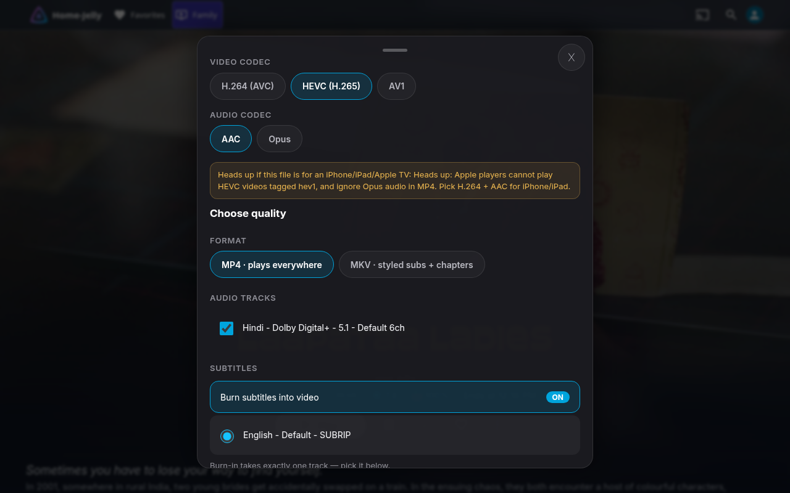
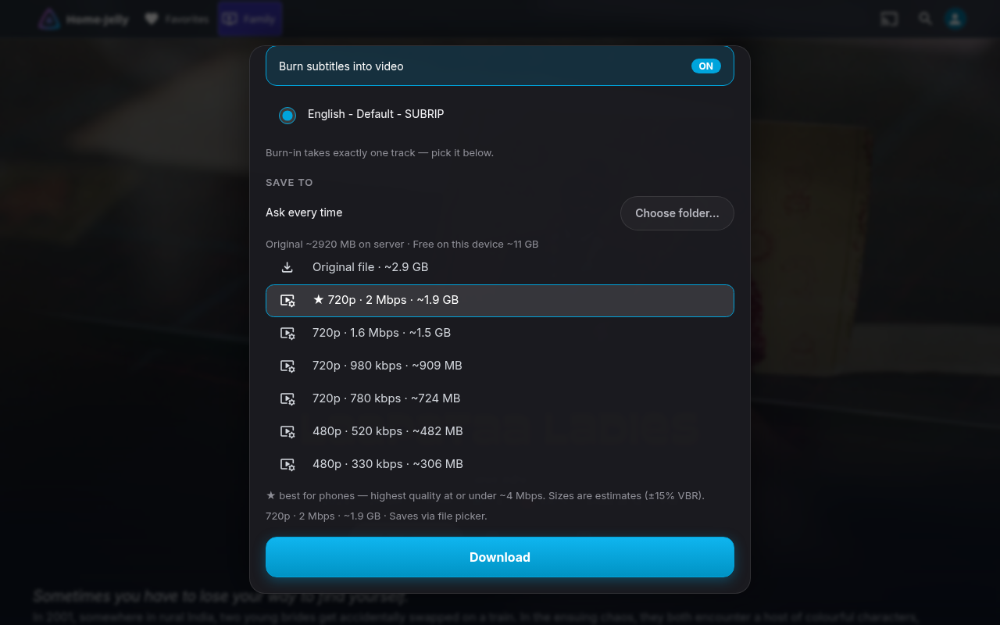
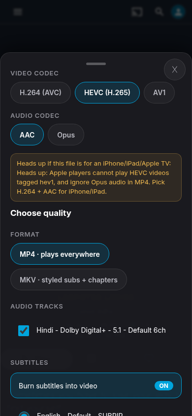

# Transcode Downloader for Jellyfin

[](https://github.com/BlackPool25/Jellyfin-Transcode-Downloader/releases)
[](https://jellyfin.org)

A Jellyfin **server plugin** that adds a **"Download (Transcode…)"** entry to the ⋯ menu on
every movie and episode. Pick a codec, quality, audio and subtitle setup — Jellyfin transcodes
on the fly (hardware-accelerated where available) and the file downloads with a live progress
bar and a proper filename like `Dune (2021) [HEVC 4Mbps AAC].mp4`.

Forked from [ph15ch/Jellyfin-Transcode-Downloader](https://github.com/ph15ch/Jellyfin-Transcode-Downloader)
and brought up to Jellyfin 12.x with a rebuilt phone-first UI.



## Features

**Downloads, your way**
- **Transcoded downloads with a quality picker** — H.264 / HEVC / AV1 video, AAC / Opus
  audio, per-codec bitrate tiers, all hardware-accelerated when your server supports it.
- **Original-file downloads** — a dedicated `Original file` row skips the transcode entirely
  when the source already fits (no re-encode, no wait, all tracks included). The picker even
  tells you when a transcode tier would be pointless.
- **Smart defaults** — the ★ rung is auto-picked (best quality at or under ~4 Mbps), and the
  codec defaults to HEVC where your server and device support it (never auto-picked on Apple
  devices; AV1 is offered but never default).
- **MP4 or MKV output** — MKV keeps styled subtitles and chapters.

**Audio & subtitles, done right**
- **Multi-select audio tracks** — first checked track goes in the file; extra tracks queue
  as their own full downloads, each clearly labeled.
- **Subtitle modes** — burn-in toggle (exactly one track, the only faithful path for styled
  ASS / image PGS subs) or soft subs with multi-pick (first embedded, the rest download as
  `.srt` sidecars). Uncheck everything for no subtitles.
- **Per-episode resolution in batches** — every episode's tracks are resolved individually.
  A **pre-download review** groups mismatches by season
  (`E7 audio → default, no subs`) with **Download all** or **Skip flagged**.
- HDR sources trigger a tone-mapping note; Apple devices get HEVC/Opus/MKV warnings only
  when relevant.

**Batch & library-friendly**
- **Whole seasons and series** — ⋯ menus on seasons/series open a season checklist with
  episode counts, then one quality sheet fans out to everything.
- **Real folder output** — batches land in `Series/Season NN/` subfolders, filenames matching
  your library convention (`Show (2017) - S01E01 [H264 4Mbps AAC].mp4`).
- **Saved download folder** — pick a folder once (remembered across sessions); every single
  and batch download goes there automatically. Change or forget it anytime.
- **Resilient queue** — serial downloads with live progress, per-item cancel, failed rows
  stay with the reason and a **Retry** button, and waiting items survive a browser restart.




## Install (2 minutes)

**Option A — plugin catalog (recommended, auto-updates on restart):**

1. In Jellyfin go to **Dashboard → Plugins → Repositories → Add** and paste:
   `https://raw.githubusercontent.com/BlackPool25/Jellyfin-Transcode-Downloader/main/repo/manifest.json`
2. **Dashboard → Plugins → Catalog** → install **Transcode Downloader**.
3. Restart Jellyfin.

**Option B — manual install:**

1. Download the zip from the
   [latest release](https://github.com/BlackPool25/Jellyfin-Transcode-Downloader/releases).
2. Extract `Jellyfin.Plugin.TranscodeDownloader.dll` (+ `logo.png`) into a folder named
   `Transcode Downloader_<version>` inside your Jellyfin `plugins` directory
   (e.g. `/config/plugins/` on Docker), owned by the Jellyfin user.
3. Restart Jellyfin.

Requires **Jellyfin 12.x** (built against the 12.4 SDK). No companion plugins needed —
the script injects itself in memory and survives web updates.

## Usage

1. Open any movie or episode → **⋯ menu → Download (Transcode…)**.
   (Use Jellyfin's own **Download** button for the untouched original.)
2. Pick codec, format, audio and subtitle tracks. The summary line shows exactly what
   you'll get: `1080p · 4 Mbps · ~890 MB · Saves into 📁 Downloads.`
3. Pick a quality (★ = recommended) and press **Download**.
   - Desktop Chrome/Edge: a save dialog (or your saved folder — set it once via
     **Save to → Choose folder…**).
   - Jellyfin Android app / mobile browsers / other browsers: the download hands off to
     the browser with the real filename — track it in your downloads list.
4. Season/series pages get their own entries: check seasons → quality → review →
   pick a folder once → `Series/Season NN/` fills up with progress per episode.

## Compatibility

| Client | Status |
|---|---|
| Jellyfin web (Chrome/Edge/Firefox desktop) | Full picker, queue, stream-to-disk saves |
| Jellyfin Android app | Full picker; downloads hand to the system browser with real filenames |
| Mobile browsers (Android Chrome, iOS Safari) | Full picker; single downloads via browser (no save picker on mobile) |
| iOS / Safari / Apple TV targets | H.264 + AAC recommended; HEVC/Opus/MKV flagged before you start |
| Jellyfin TV apps | Not applicable — native UIs with no web action sheets |

Server-side it uses your existing Jellyfin transcode pipeline (VA-API/NVENC/QSV incl.
HDR tone-mapping where configured), so no extra setup beyond what playback already needs.

## Troubleshooting / FAQ

**I don't see "Download (Transcode…)".**
Hard-refresh the web client (`Ctrl+Shift+R`, or long-press reload on mobile). The page
caches `index.html` from before the plugin was installed. Verify with:
`document.querySelector('script[src*="TranscodeDownloader"]')` in DevTools console —
it should end in the installed version (e.g. `?v=1.5.1.0`).

**The file is bigger than expected / quality looks unchanged.**
VBR encoding varies ±15% around the estimate. If you picked a rung at/above the source
bitrate the plugin now warns you (`identical to the original`) — take Original instead.

**My subtitles are missing / unstyled.**
ASS styling and PGS image subs only survive via **burn-in** (toggle it on, pick the one
track). Soft-embed (`mov_text` in MP4) strips styling; MKV preserves more. Extra checked
languages always arrive as `.srt` sidecars.

**Downloads fail with HTTP 401.**
On Jellyfin 12+, legacy `?api_key=` auth is rejected server-side. This fork sends the
session token correctly (header in-page, `?ApiKey=` for browser handoffs). If you see
401s, hard-refresh first — a stale cached script is the usual cause.

**Tapped Download in the Android app and nothing happened?**
Hard-refresh the web view first (reopen the library view) so you have the latest script —
a stale cached copy is the usual cause. On tap you should see a *"Handed to your
browser"* notice; if the browser never opens, update the Jellyfin Android app (older
versions lack the handoff bridge the plugin calls). If the browser opens but shows an
error, open that same URL in the browser while on the same network as the server.

**Batch stopped / tab closed mid-download.**
Waiting items persist and resume from zero on next load (you'll get a notice). An
interrupted file is never kept as a "success" — failed rows stay with Retry.

**A transcode never finishes / freezes.**
Long 4K software encodes (especially AV1) can take hours; the queue has a stall guard.
Prefer HEVC + hardware, or drop a rung.

## Development

Prerequisites: .NET 10 SDK (`mcr.microsoft.com/dotnet/sdk:10.0` works for the Docker-only
crowd) and Node.js (for the headless UI tests in [`tests/`](tests/) — see below).

```bash
dotnet build src/JellyfinTranscodeDownloader.csproj -c Release
dotnet publish src/JellyfinTranscodeDownloader.csproj -c Release -o publish/ -p:Version="X.Y.Z"
```

Headless UI tests live in [`tests/`](tests/) (jsdom — no browser needed):

```bash
cd tests && npm install && npm test
```

`smoke.js` drives the real `web/plugin.js`: sheet open → tier pick → codec toggle →
download to 100% → queue clear → Original download. `clients-matrix.js` asserts 21
behaviours across simulated Android app, iOS Safari, desktop Chromium and mobile
browser profiles. Both fail on any `ReferenceError`.

- `web/plugin.js` is the entire client (embedded resource, served at
  `/TranscodeDownloader/ClientScript`). No build step, no framework.
- Static checks + headless flow tests live next to the repo (jsdom harness covering
  open → pick → download → 100% → queue clear, mobile/Android/iOS profiles).
- Releases are manual: tag `vX.Y.Z` (annotated, changelog as the message), publish the
  DLL + `logo.png` as `jellyfin-transcode-downloader_X.Y.Z.zip`, prepend the entry to
  `repo/manifest.json` (`targetAbi` = Jellyfin line, e.g. `12.4.0.0`).

## License status — read before reusing

The upstream project has **no license** (no LICENSE file, no declaration anywhere —
GitHub reports `license: null`), so by default it is all rights reserved. That means
**this fork is not MIT/GPL/Apache licensed either** — see [NOTICE](NOTICE). The changes
made here are the fork author's own work, but only the upstream author can license the
combined codebase. A license request will be opened upstream; until it lands, treat this code
as personal-use only. Do not copy it into your own projects yet.

## Credits

Upstream project by [ph15ch](https://github.com/ph15ch/Jellyfin-Transcode-Downloader) and
contributors — the menu injection, transcode flow and queue design originate there. This
fork ports it to Jellyfin 12, adds the phone-first UI, tracks/subtitles handling, batch
folders, saved locations and mobile support. Jellyfin itself is
[GPL-licensed](https://github.com/jellyfin/jellyfin); this plugin carries no license of its
own yet — see [License status](#license-status--read-before-reusing) above.
